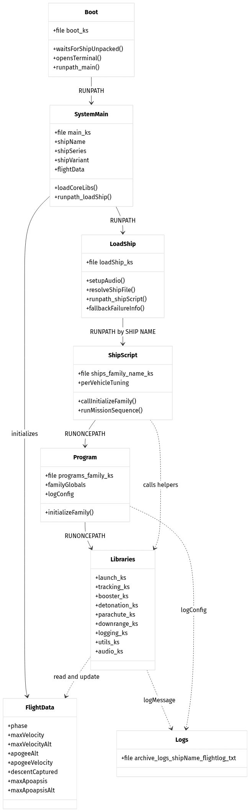
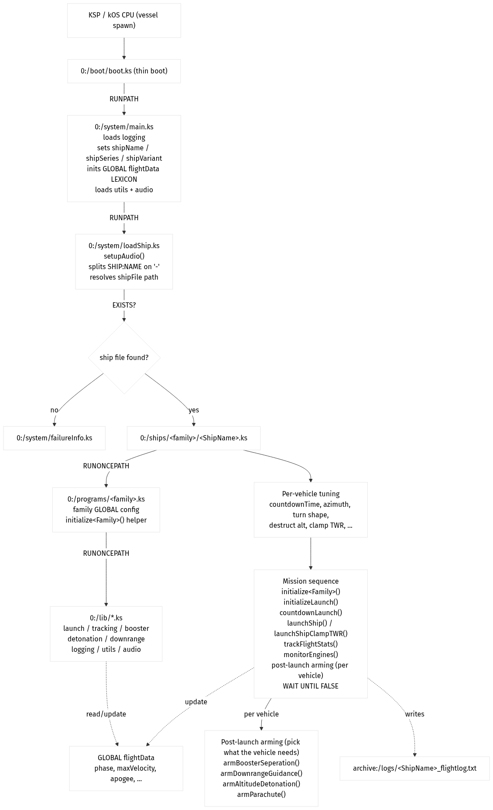
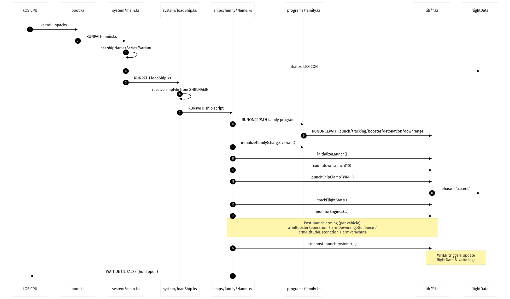
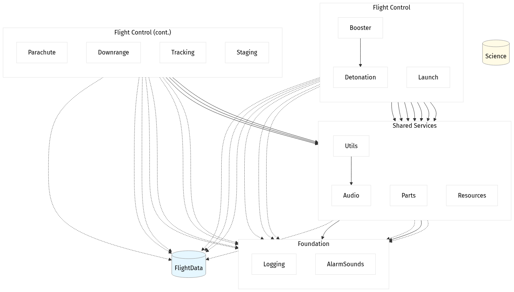
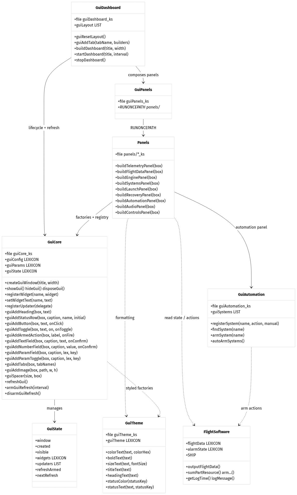
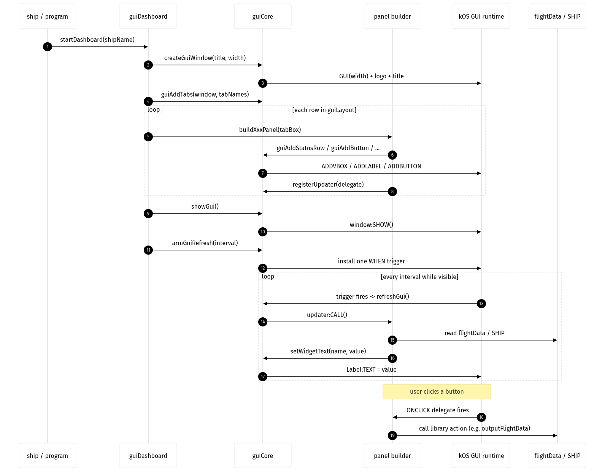

# Cosmic Fleet Vehicle Control and Guidance Systems


This document is a general reference for the fictional in-game space agency called the "Cosmic Fleet". It contains the software that pilots and supports all missions based on which vessel is loaded into the system.

**Contributions:** This repository is for the systems built during my  time playing this game, you are free  to copy the design approach and reuse scripts in your own gameplay but no PRs or issues please, use this work as reference for your own creative approach for best satisfaction, where varients of this sytem are made for you own kOS repos, if you stick with the design approach and script flow foundations layed out here then credit is aprechiated. Ships will not be shared here, please if using these scripts do so with your own designs and playstyle.

The primary  purpose of this repo is for a video game and to have fun, therefore a certain level simplicity over complexity is adopted so  I am not spending all my time writing code when I want to fly rockets.

## kOS Scripts for KSP (RO/RP1)

KerboScript scripts for the [kOS](https://ksp-kos.github.io/KOS/) mod, written for Kerbal Space Program with the Realism Overhaul / Realistic Progression 1 modset. They cover prelaunch checks, clamp-held ignition, downrange guidance, flight tracking, engine monitoring, an audio driver, a logging system, parachute recovery, and a safety destruct.

This is a personal project that grows mission by mission. Layout and conventions are stable, but ships, programs, and tunings are added or changed as new vehicles are designed and flown. Scripts are tested in the in-game simulation feature before being used on career flights.

## Usage
These scripts are largely dependent on my ship designs but if you want to make a copy to adapt to your own but reuse and adapt libraries or the boot flow be sure to directly clone the contents of this repo to your ``[KSP Directory]\Ships\Script`` folder then use boot.ks on your ships kOS boot file setting in-game.

## Volume layout

All paths below are relative to the kOS archive volume `0:/`.

```
boot/        kOS boot files. Tiny by design - they only kick off main.ks.
system/      Bootstrap, ship dispatch, failure screens, audio test harness.
lib/         Reusable libraries. Pure helpers and orchestration functions.
lib/sounds/  Note tables for the audio driver.
lib/gui/     Shared GUI toolkit (widgets, shared panels, refresh loop). Kept separate from flight-control libraries.
programs/    Per-family mission programs (one .ks per ship family).
gui/         Per-family dashboards (one .ks per ship family): layout + that family's unique panels.
ships/       Per-ship entry scripts, organised by family folder.
logs/        Flight logs written by the logger. Contents are gitignored.
docs/        One markdown file per script describing purpose and functions.
```

### Folder purposes

- **boot/** - Set the active boot file in the VAB/SPH on the kOS part. The boot script just waits for the vessel to unpack, opens the terminal, and runs `0:/system/main.ks` (or a test harness). Keep these files small to stay under the kOS module storage limit.
- **system/** - One-time wiring that runs at vessel start. Initialises global flight state, loads shared libraries, dispatches to the right ship script based on `SHIP:NAME`, and contains failure messages for misnamed vessels.
- **lib/** - Library code. Files only declare functions and small `GLOBAL` config lexicons. No vessel control runs at import time. Anything that locks steering, stages, or arms a `WHEN` trigger lives inside a function that the program/ship script calls explicitly.
- **lib/sounds/** - Note and song definitions consumed by `lib/audio.ks`. One file per audio category (launch, alert, alarm).
- **lib/gui/** - Optional shared GUI toolkit, kept separate from the flight-control libraries. A modular stack (theme, core framework, shared panels, dashboard) that reads shared state and calls existing library functions but never controls the vessel itself. `RUNONCEPATH("0:/lib/gui/gui.ks")` loads it; see [lib/gui/README.md](lib/gui/README.md).
- **programs/** - One file per ship family. Imports the libraries the family needs, loads the family dashboard (`gui/<family>.ks`), declares family-wide globals (engine tags, resource names, thresholds), defines family-specific helpers (telemetry action groups, init banner), registers armable systems, and configures logging.
- **gui/<family>.ks** - The dashboard for one ship family: its window layout (which tabs, which panels, in what order, filtered by variant) plus any panels unique to that family. Built from the shared `lib/gui/` toolkit and loaded by the family program. Mirrors how `programs/` splits flight logic per family.
- **ships/<family>/<ShipName>.ks** - The actual entry point for one vehicle. Imports its family program, sets per-vehicle tags and tunings, seeds per-ship GUI values, then runs the launch sequence and arms post-launch systems. Vehicles in a series share the family program and dashboard; tunings live here so two variants can fly differently.
- **logs/** - Output target for `logMessage`. Each ship gets its own `<ShipName>_flightlog.txt`. Contents are gitignored; the folder is kept via `.gitkeep`.
- **docs/** - One markdown file per script. Each doc lists the script's purpose and a one-line summary of every function it exposes. Update the doc when you change a script's public surface; see `docs/_template.md`.

## System architecture

The repo is split into five layers. Each layer only imports from layers below it, and the lower layers never know about the upper ones.



- **Ship scripts** (`ships/<family>/<Name>.ks`) — the per-vehicle entry point. Sets part tags, resource names, guidance numbers, and composes the launch + post-launch sequence.
- **Family programs** (`programs/<family>.ks`) — shared by every vehicle in a family. Imports the libraries it needs, declares family-wide globals, sets up logging, and exposes helpers such as `initialize<Family>()`.
- **Libraries** (`lib/*.ks`) — pure helpers and orchestration. Math, resource sums, TWR, formatting, plus functions that arm `WHEN` triggers. No library runs vessel control at import time.
- **System bootstrap** (`system/*.ks`) — one-time wiring that runs when the vessel loads. Dispatches from `main.ks` to the right ship script via `loadShip.ks`.
- **Boot files** (`boot/*.ks`) — minimal kOS boot entries. They only wait for the vessel to unpack, open the terminal, and run `system/main.ks`.

Read top-down to add a vehicle. Read bottom-up to add a capability that several families will share.

### Boot flow

When a vessel loads, control flows from the kOS CPU down through the bootstrap and into the ship-specific script.



1. `boot/boot.ks` waits for `SHIP:UNPACKED`, opens the terminal, and `RUNPATH`s `system/main.ks`.
2. `system/main.ks` loads `lib/logging.ks`, initialises the global `flightData` lexicon, and `RUNPATH`s `system/loadShip.ks`.
3. `system/loadShip.ks` splits `SHIP:NAME` on `-` to find the family and variant, resolves `ships/<family>/<ShipName>.ks`, and either runs that ship script or falls back to `system/failureInfo.ks` if the name is unknown.
4. The ship script `RUNONCEPATH`s its family program (which loads the rest of `lib/`), applies per-vehicle tuning, runs the launch sequence, and arms any post-launch systems the vehicle needs.
5. The script ends with `WAIT UNTIL FALSE` so the armed `WHEN` triggers stay alive.

A more detailed view of the same flow, including the sequence of calls between files, is shown below.



### Library dependency map

The flight-control libraries depend on a small set of shared services. Solid arrows show a direct call/import; dashed arrows show a "uses" relationship such as logging or reading the shared `flightData` state.



- **Flight Control** — `booster`, `launch`, `detonation`, `parachute`, `downrange`, `tracking`, `staging`. These are the high-level behaviours a ship script can arm.
- **Shared Services** — `parts` (tag-based module action resolution), `resources` (resource discovery by tag), `utils` (common helpers and `outputFlightData`), and `audio` (sound/alarm driver).
- **Foundation** — `logging` (the single `logMessage` sink and `logConfig`) and `alarmSounds` (tone tables).
- **State** — `flightData` is the global lexicon every layer reads and updates; `science` is self-contained and only reads `SHIP:PARTS`.

## GUI architecture (optional)

The shared GUI toolkit under `lib/gui/` is kept separate from the flight-control libraries. It is a modular stack built on kOS's built-in GUI widgets.



- **guiTheme** — colour/text helpers used by the other GUI modules.
- **guiCore** — window lifecycle, widget registry, refresh loop, and factory helpers for labels, buttons, toggles, fields and tabs.
- **guiPanels** — loader that `RUNONCEPATH`s every panel builder under `lib/gui/panels/`.
- **Panels** (`lib/gui/panels/*.ks`) — builders such as `buildTelemetryPanel`, `buildEnginePanel`, `buildLaunchPanel`. They use guiCore factories and register updater delegates.
- **guiAutomation** — registry for armable systems so the automation panel can turn triggers on/off.
- **guiDashboard** — composes tabs and panels into a complete dashboard and starts/stops the refresh loop.

A family dashboard lives at `gui/<family>.ks` and is loaded by the matching `programs/<family>.ks`.

The sequence below shows how a dashboard is constructed and refreshed at runtime.



1. The ship/program calls `startDashboard(shipName)`.
2. `guiDashboard` asks `guiCore` to create the window and tabs, then loops over the layout, calling each panel builder.
3. Each builder registers widgets and updaters with `guiCore`.
4. `guiCore` arms a single `WHEN` trigger that fires every refresh interval.
5. On each tick the registered updaters read `flightData` / `SHIP` and push new text into the widgets.

## Logger

All flight-relevant output goes through `logMessage` from `lib/logging.ks`:

```
logMessage(message, messageType, consoleTimestamp, playSound, outputToConsole).
```

`messageType` is a short tag rendered as `[TAG]` in the console and log file. Tags drive optional alert sounds. Stick to existing tags so log files stay greppable. Per-script docs note which tags each script emits.

## Adding a new ship

1. Pick a family. If the family does not exist yet, add `programs/<family>.ks` first.
2. Create `ships/<family>/<ShipName>.ks`. The file name must match the in-game vessel name exactly (case-sensitive, with the `-` separator that `loadShip.ks` splits on).
3. Copy the structure of an existing ship in the same family. Override per-vehicle values at the top.
4. Add a matching `docs/ships/<family>/<ShipName>.md` from `docs/_template.md`.
5. Test in the in-game simulation feature before flying for career.

## Adding a new library

1. Create `lib/<name>.ks`. Functions only, plus optional `GLOBAL` config lexicons. No `LOCK`, `STAGE`, `WAIT`, or `WHEN` at the top level.
2. Add `docs/lib/<name>.md` from the template.
3. Have the relevant `programs/<family>.ks` `RUNONCEPATH` it.

## Conventions

- Statements end with `.`, including closing braces (`}.`).
- 4-space indent, no tabs.
- `camelCase` for functions and variables. Part tags are short uppercase strings on the part itself.
- Prefer `LOCAL` for function-internal state. `GLOBAL` only for cross-module shared state (`flightData`, `shipName`, `logConfig`).
- Prefer `SHIP:PARTSTAGGED("...")` over part-name lookups so part renames in mods do not break scripts.
- Libraries import with `RUNONCEPATH`. Entry/dispatch scripts use `RUNPATH`.

## Per-script docs index

| Script | Doc |
| --- | --- |
| Read-as-you-go system manual | [docs/system/scriptSystemManual.md](docs/system/scriptSystemManual.md) |
| `boot/boot.ks` | [docs/boot/boot.md](docs/boot/boot.md) |
| `boot/audioTests.ks` | [docs/boot/audioTests.md](docs/boot/audioTests.md) |
| `system/main.ks` | [docs/system/main.md](docs/system/main.md) |
| `system/loadShip.ks` | [docs/system/loadShip.md](docs/system/loadShip.md) |
| `system/failureInfo.ks` | [docs/system/failureInfo.md](docs/system/failureInfo.md) |
| `system/testAudio.ks` | [docs/system/testAudio.md](docs/system/testAudio.md) |
| `lib/logging.ks` | [docs/lib/logging.md](docs/lib/logging.md) |
| `lib/audio.ks` | [docs/lib/audio.md](docs/lib/audio.md) |
| `lib/utils.ks` | [docs/lib/utils.md](docs/lib/utils.md) |
| `lib/launch.ks` | [docs/lib/launch.md](docs/lib/launch.md) |
| `lib/booster.ks` | [docs/lib/booster.md](docs/lib/booster.md) |
| `lib/tracking.ks` | [docs/lib/tracking.md](docs/lib/tracking.md) |
| `lib/downrange.ks` | [docs/lib/downrange.md](docs/lib/downrange.md) |
| `lib/detonation.ks` | [docs/lib/detonation.md](docs/lib/detonation.md) |
| `lib/parachute.ks` | [docs/lib/parachute.md](docs/lib/parachute.md) |
| `lib/sounds/launchSounds.ks` | [docs/lib/sounds/launchSounds.md](docs/lib/sounds/launchSounds.md) |
| `lib/sounds/alertSounds.ks` | [docs/lib/sounds/alertSounds.md](docs/lib/sounds/alertSounds.md) |
| `lib/sounds/alarmSounds.ks` | [docs/lib/sounds/alarmSounds.md](docs/lib/sounds/alarmSounds.md) |
| GUI system overview, concepts, and recipes | [lib/gui/README.md](lib/gui/README.md) |
| GUI full function reference + architecture | [lib/gui/REFERENCE.md](lib/gui/REFERENCE.md) |
| `lib/gui/guiTheme.ks` | [docs/lib/gui/guiTheme.md](docs/lib/gui/guiTheme.md) |
| `lib/gui/guiCore.ks` | [docs/lib/gui/guiCore.md](docs/lib/gui/guiCore.md) |
| `lib/gui/guiAutomation.ks` | [docs/lib/gui/guiAutomation.md](docs/lib/gui/guiAutomation.md) |
| `lib/gui/guiPanels.ks` | [docs/lib/gui/guiPanels.md](docs/lib/gui/guiPanels.md) |
| `lib/gui/panels/telemetryPanel.ks` | [docs/lib/gui/panels/telemetryPanel.md](docs/lib/gui/panels/telemetryPanel.md) |
| `lib/gui/panels/flightDataPanel.ks` | [docs/lib/gui/panels/flightDataPanel.md](docs/lib/gui/panels/flightDataPanel.md) |
| `lib/gui/panels/enginePanel.ks` | [docs/lib/gui/panels/enginePanel.md](docs/lib/gui/panels/enginePanel.md) |
| `lib/gui/panels/systemsPanel.ks` | [docs/lib/gui/panels/systemsPanel.md](docs/lib/gui/panels/systemsPanel.md) |
| `lib/gui/panels/launchPanel.ks` | [docs/lib/gui/panels/launchPanel.md](docs/lib/gui/panels/launchPanel.md) |
| `lib/gui/panels/paramsPanel.ks` (deprecated, unused) | [docs/lib/gui/panels/paramsPanel.md](docs/lib/gui/panels/paramsPanel.md) |
| `lib/gui/panels/recoveryPanel.ks` | [docs/lib/gui/panels/recoveryPanel.md](docs/lib/gui/panels/recoveryPanel.md) |
| `lib/gui/panels/automationPanel.ks` | [docs/lib/gui/panels/automationPanel.md](docs/lib/gui/panels/automationPanel.md) |
| `lib/gui/panels/audioPanel.ks` | [docs/lib/gui/panels/audioPanel.md](docs/lib/gui/panels/audioPanel.md) |
| `lib/gui/panels/controlsPanel.ks` | [docs/lib/gui/panels/controlsPanel.md](docs/lib/gui/panels/controlsPanel.md) |
| `lib/gui/guiDashboard.ks` | [docs/lib/gui/guiDashboard.md](docs/lib/gui/guiDashboard.md) |
| Template for new docs | [docs/_template.md](docs/_template.md) |

### Branch layout

This repository uses two long-lived branches:

- **`main`** - framework only. `boot/`, `system/`, `lib/`, the shared `docs/`, and the generic diagrams under `docs/images/`. No family programs or ship scripts are tracked here so the published framework stays vehicle-agnostic. Anyone wanting to use this framework for their own games should clone from `main`.
- **`Anymuz-Personal`** - my personal play-through. Identical to `main` for everything above, plus the actual `programs/<family>.ks` and `ships/<family>/<ShipName>.ks` files used in my own career save. This is the only place family programs and per-vehicle scripts live. Since they are unique to my designs they can be used as examples but wont conform to other ship designs.

The `personal/` folder at the repo root is reserved for local-only artefacts (legacy ship scripts, personal failure-info overrides, per-family doc snapshots) and is gitignored on both branches.
