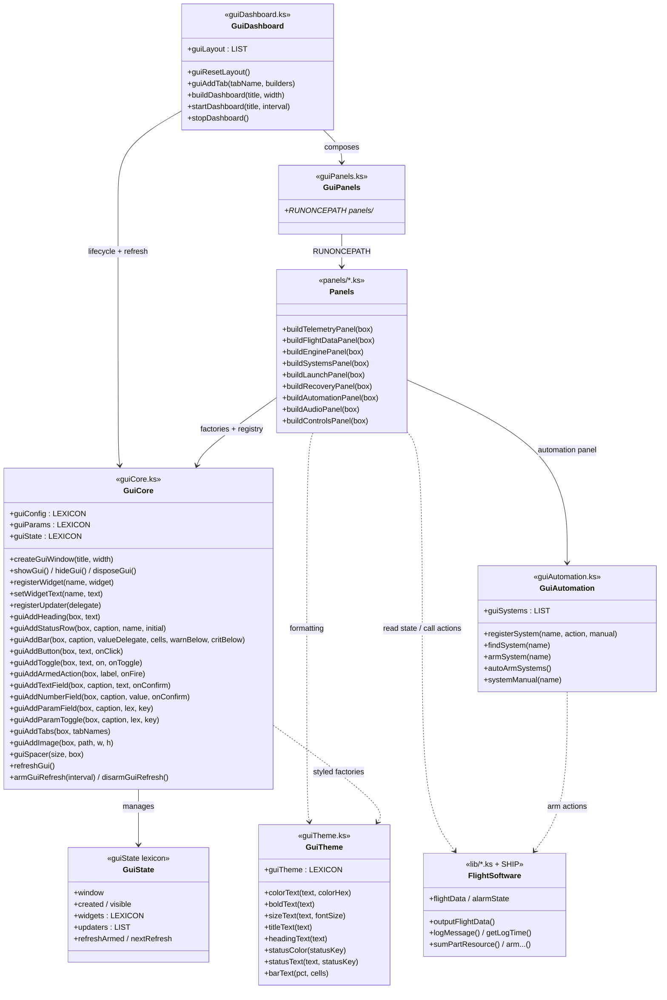

# GUI System — Function Reference & Architecture

Complete reference for every public function in the `lib/gui/` stack, plus a
module diagram showing how the pieces fit together. For the conceptual
walkthrough, recipes, and current file layout, start with [README.md](README.md)
— this doc is the dry "what does each function do and where does it live"
companion.

Every statement in kerboscript ends in `.` (including the `}` closing a block).
A *delegate* is a function handed to kOS: `myFunc@` (a named function, resolved
immediately) or `{ ... }` (an inline anonymous function, resolved on call).

---

## Contents

- [Architecture at a glance](#architecture-at-a-glance)
- [Class / module diagram](#class--module-diagram)
- [`guiTheme.ks` — theme & rich text](#guithemeks--theme--rich-text)
- [`guiCore.ks` — window, registry, factories, refresh](#guicoreks--window-registry-factories-refresh)
- [`guiAutomation.ks` — armable-system registry](#guiautomationks--armable-system-registry)
- [`guiDashboard.ks` — layout & lifecycle](#guidashboardks--layout--lifecycle)
- [`guiPanels.ks` / `gui.ks` — loaders](#guipanelsks--guiks--loaders)
- [Panel builders (`panels/*.ks`)](#panel-builders-panelsks)
- [Shared state lexicons](#shared-state-lexicons)

---

## Architecture at a glance

Now the big picture. The system is layered, and dependencies point **downward** —
a file only ever calls functions defined *below* it, never above. That's what
keeps it maintainable: you can read any one layer without understanding the ones
on top of it.

```
gui.ks                     (loader manifest — guiTheme, guiCore, guiAutomation, guiDashboard, in order)
  └── guiDashboard.ks      (orchestration: guiLayout, buildDashboard, startDashboard - generic fallback)
        └── guiCore.ks       (window, widget registry, factories, refresh loop)
              └── guiTheme.ks (colours, sizes, rich-text string helpers)
  guiAutomation.ks           (armable-system registry - side module, no panel currently renders it)
  panels/*.ks                (buildXxxPanel: one vehicle aspect each; most are currently retired)
```

Although kerboscript isn't class-based, the design is effectively object-oriented:
each file is a *module* (like a class) exposing functions (methods) that operate
on shared state objects (`guiState`, `guiConfig`, `guiParams`). What each layer is
actually *for*, top to bottom:

- **`gui.ks`** — a one-line "install everything" convenience. `RUNONCEPATH` this
  one file and nothing else.
- **`guiDashboard.ks`** — the generic-fallback **boss**. Knows the list of tabs
  and which panels go on each (`guiLayout`), via `startDashboard`/`stopDashboard`.
  Real families bypass this and write their own `start<Family>Gui` instead (see
  README).
- **`guiCore.ks`** — the **engine**. Window lifecycle, the widget registry, all
  the `guiAdd...` factories, and the refresh loop. Every panel is built entirely
  out of calls into here.
- **`guiTheme.ks`** — the **paint**. Colours, font sizes, and helper functions
  that wrap text in colour/bold tags. Pure formatting, no widgets.
- **`guiAutomation.ks`** — a **side module**. A registry of "armable systems",
  each with a register-time AUTO/MANUAL flag.
- **`panels/*.ks`** — reusable panel builders. Only `resourcesPanel.ks` and
  `sciencePanel.ks` are currently loaded by a live dashboard; the rest (plus
  their loader, `guiPanels.ks`) were retired when families moved to bespoke
  dashboards.

The design rules that follow from this:

1. **The window is a tree of boxes.** Widgets go into boxes; every builder takes a
   `parentBox` parameter so it knows where to hang its section.
2. **A named registry decouples "where a value lives" from "what writes it."**
   `guiAddStatusRow` stores a label under a string name; an updater later writes to
   it by that name with `setWidgetText`. Neither side needs a reference to the other.
3. **One timed trigger repaints everything.** `armGuiRefresh` installs a single
   `WHEN` trigger that calls every registered updater on an interval — no per-panel
   loops, no manual redraws.

---

## Class / module diagram



For the build→show→refresh lifecycle as a sequence diagram and the window's
visible/refreshing state machine, see the rendered diagrams in
[docs/images/gui-flow.svg](../../docs/images/gui-flow.svg) (source:
`docs/images/_src/gui-flow.mmd`) — the same trigger/registry model is walked
step-by-step in README's "How it works" section.

---

## `guiTheme.ks` — theme & rich text

**What it's for:** making text coloured, bold, or bigger — nothing more. kOS labels
accept a little markup language (the same one Unity uses): you wrap text in tags
like `<color=#ff0000>...</color>` and it renders red. Writing those tags by hand
is ugly and error-prone, so this file gives you tiny helpers that wrap the tags
for you, plus a shared palette (`guiTheme`) so every panel uses the same colours.
No widgets are created here — every function just takes a string and returns a
string with tags around it.

The one that earns its keep is `statusText`: you hand it a value and a *status
word* (`"NOMINAL"`, `"WARNING"`, `"CRITICAL"`) and it colours the value green,
amber, or red — matching the colours the console log already uses, so the GUI and
the log agree at a glance.

| Function | Signature | Does |
| --- | --- | --- |
| `colorText` | `(text, colorHex) → string` | wrap `text` in `<color=…>`; `colorHex` is a name (`"orange"`) or hex (`"#ffaa00"`). |
| `boldText` | `(text) → string` | wrap `text` in `<b>…</b>`. |
| `sizeText` | `(text, fontSize) → string` | wrap `text` in `<size=…>…</size>`. |
| `titleText` | `(text) → string` | pre-styled window title (bold + `titleSize`). |
| `headingText` | `(text) → string` | pre-styled section heading (bold + `headingSize` + accent colour). |
| `statusColor` | `(statusKey) → hex` | map a status key to a theme colour. `CRITICAL/ERROR`→red, `WARNING/ALERT/ALARM`→amber, `NOMINAL/ONLINE/OK`→green, else white. |
| `statusText` | `(text, statusKey) → string` | colour `text` by status key (combines the two above). |
| `barText` | `(pct, cells) → string` | build a fixed-width text progress bar, e.g. `[####------]` (kOS has no native bar/dial widget). `pct` is 0..100 (clamped); `cells` is the width (default 20). Wrap in `statusText(...)` to colour it. |

`guiTheme` is a lexicon of hex colours and sizes (`titleSize`, `headingSize`,
`captionWidth`, `captionColor`, `valueColor`, `nominalColor`, `alertColor`,
`criticalColor`, `accentColor`, `mutedColor`). The default palette is matched to
the COSMIC FLEET logo — scarlet `accentColor` for headings/title, silver
`captionColor`, on the dark window — with the green/amber/red status trio kept for
signalling. Edit it once to restyle everything.

```
setWidgetText("power", statusText(charge + " %", "WARNING")).   // amber value
guiAddHeading(panel, "SYSTEMS").                                 // uses headingText internally
```

---

## `guiCore.ks` — window, registry, factories, refresh

**What it's for:** this is the engine room. It does four jobs, and the tables
below are grouped by them:

1. **Window lifecycle** — make a window, show/hide it, throw it away.
2. **The registry** — the phone book that maps a name to a widget, plus the list
   of updaters.
3. **Widget factories** — the `guiAdd...` functions. Each one creates a widget
   (or a whole row), drops it in the box you gave it, wires up any callback, and
   hands it back. These are the LEGO bricks every panel is built from.
4. **The refresh loop** — the single timer that keeps live values fresh.

Everything here reads or writes the shared `guiState` lexicon, which is why you
never have to pass window handles around yourself.

### Window lifecycle

These manage the *existence* of the window. `createGuiWindow` always wipes any
previous one first (so you can't accidentally stack two), and `disposeGui`
completely tears it down and empties the registry — important, because a leftover
registry pointing at a destroyed window would break the next build.

| Function | Signature | Does |
| --- | --- | --- |
| `createGuiWindow` | `(windowTitle="kOS MISSION CONTROL", width=guiConfig["width"]) → window` | dispose any old window, build a fresh empty one (with optional logo + centred title), position it, make it draggable. |
| `showGui` | `()` | show the window; sets `visible` TRUE (refresh only runs while visible). |
| `hideGui` | `()` | hide without destroying; sets `visible` FALSE. |
| `disposeGui` | `()` | hide, destroy, and clear all registered widgets/updaters. |

### Widget registry

The glue that lets "the code that draws a label" and "the code that updates it"
not know about each other. You almost never call `registerWidget` yourself —
`guiAddStatusRow` does it for you. You *do* call `setWidgetText` (from inside
updaters) and `registerUpdater` (once per panel) constantly.

| Function | Signature | Does |
| --- | --- | --- |
| `registerWidget` | `(widgetName, widget) → widget` | store a widget under a string name. |
| `setWidgetText` | `(widgetName, text)` | set that widget's `TEXT`; silently ignores unknown names. |
| `registerUpdater` | `(updater)` | add a no-arg delegate to be called on every refresh. |

### Widget factories

The workhorses. Every one takes the target `box` as its first argument (that's
*where* the widget goes), builds the widget, and returns it. The ones ending in a
delegate parameter (`onClick`, `onToggle`, `onConfirm`, `onFire`) wire that
function to the user action. Rule of thumb: **`guiAddStatusRow` for things you
display, the rest for things the user touches.**

A note on the "param" pair: `guiAddParamField` / `guiAddParamToggle` are shortcuts
for "a field that edits one entry in a lexicon." You give them a lexicon and a
key; they show the current value and write the edited value straight back into
`lex[key]`. Drop one onto the panel that controls the relevant system to make a
`guiParams` value editable in place — there is no separate PARAMS tab.

| Function | Signature | Adds |
| --- | --- | --- |
| `guiAddHeading` | `(parentBox, text)` | an accent section-heading label. |
| `guiAddImage` | `(parentBox, imagePath, width=96, height=96)` | a PNG from the archive at a fixed size (path archive-relative, no `0:/`, `.png` optional). |
| `guiAddStatusRow` | `(parentBox, caption, widgetName, initialValue="--")` | a "caption : value" row; the value label is registered under `widgetName`. |
| `guiAddBar` | `(parentBox, caption, valueDelegate, cells=20, warnBelow=40, critBelow=15)` | a self-updating `caption : [bar] pct%` gauge row. `valueDelegate` is a no-arg delegate returning 0..100, polled each refresh (must not `WAIT`); auto-colours NOMINAL/WARNING/CRITICAL. Registers its own updater. |
| `guiAddButton` | `(parentBox, text, onClick)` | a button wired to a **no-arg** delegate. |
| `guiAddToggle` | `(parentBox, text, initialOn, onToggle)` | a checkbox wired to a **one-Boolean** delegate (`PARAMETER isOn`). |
| `guiAddArmedAction` | `(parentBox, label, onFire)` | an ARM checkbox + button; the no-arg `onFire` fires only when ARM is ticked, then auto-disarms. |
| `guiAddTextField` | `(parentBox, caption, initialText, onConfirm)` | a text input; `onConfirm(String)` fires on Enter/blur. |
| `guiAddNumberField` | `(parentBox, caption, initialValue, onConfirm)` | a numeric input; `onConfirm(number)` fires on Enter/blur (falls back to `initialValue` if unparseable). |
| `guiAddParamField` | `(parentBox, caption, lexIn, key)` | a number field two-way bound to `lexIn[key]`. |
| `guiAddParamToggle` | `(parentBox, caption, lexIn, key)` | a checkbox two-way bound to Boolean `lexIn[key]`. |
| `guiAddTabs` | `(parentBox, tabNames) → LEXICON` | a tab strip; returns `name → content box`. Build panels into `pages[name]`. |
| `guiSpacer` | `(size=5, parentBox=window)` | blank spacing in pixels (`-1` = flexible). |

### Refresh loop

The heartbeat. `armGuiRefresh` is the clever bit: it installs the `WHEN` trigger
**only once**, then just updates a "next refresh time" variable on subsequent
calls, so you can safely call it again without stacking up triggers. `refreshGui`
is the thing the trigger calls — and it quietly does nothing if the window is
hidden, so a hidden dashboard costs almost nothing.

| Function | Signature | Does |
| --- | --- | --- |
| `refreshGui` | `()` | call every registered updater once; no-op unless created **and** visible. |
| `armGuiRefresh` | `(interval=guiConfig["refreshInterval"])` | install (once) a `WHEN` trigger that calls `refreshGui()` every `interval` seconds; re-arming only updates the interval. |
| `disarmGuiRefresh` | `()` | stop the trigger from running (stays installed but dormant). |

> **Trigger safety:** button, toggle, field and updater delegates all run as
> triggers — keep them short and **never `WAIT`** inside one. For an action that
> must wait, flip a flag and let mainline code react.

```
LOCAL panel IS parentBox:ADDVBOX().
guiAddHeading(panel, "SPEED").
guiAddStatusRow(panel, "Vertical", "spdV").          // registered as "spdV"
registerUpdater({ setWidgetText("spdV", ROUND(SHIP:VERTICALSPEED,1)+" m/s"). }).
```

---

## `guiAutomation.ks` — armable-system registry

**What it's for:** letting the pilot take over an automatic system — destruct,
parachute — at *any* point in flight. Normally the ship arms these and they run on
their own. This file is a little bookkeeping list (`guiSystems`) plus a live
AUTO/MANUAL switch per system.

The idea: you **register** each system once, giving it a name, an *arm action*
(a delegate that sets up the automatic logic), and an optional starting AUTO/MANUAL
state. At post-launch you call `autoArmSystems()`, which arms every registered
system. Each system's automatic action then checks `systemManual(name)` right
before it fires: **AUTO** → it fires; **MANUAL** → it holds, and the pilot triggers
it from that system's own panel (e.g. the RECOVERY tab's SELF DESTRUCT). There is
no live switch - manual mode is fixed at registration time.

Each entry is `LEXICON("name", …, "action", <delegate>, "armed", <bool>, "manual", <bool>)`.

| Function | Signature | Does |
| --- | --- | --- |
| `registerSystem` | `(name, action, manual=FALSE)` | register a system; `action` is a no-arg delegate that performs the arming (capturing the ship's parameters). |
| `findSystem` | `(name) → LEXICON \| 0` | look up a registered system by name. |
| `armSystem` | `(name)` | arm one system now; **idempotent** (does nothing if already armed). Called by `autoArmSystems`. |
| `autoArmSystems` | `()` | arm every registered system. Call this where the ship used to arm things directly. |
| `systemManual` | `(name) → bool` | TRUE if the system is registered and in MANUAL. Autonomous code checks this before firing; unknown systems return FALSE. |

`guiSystems` is the backing `LIST`. Register systems **before** `startDashboard`
so the AUTOMATION panel can list them.

```
// family program: register once
registerSystem("Destruct", { armAltitudeDetonation(guiParams["destructAlt"], guiParams["useRadarAlt"]). }).
// ship script at post-launch: arm every registered system
autoArmSystems().
// the system's lib gates its automatic action:
//   IF systemManual("Destruct") { PRESERVE. } ELSE { altitudeDetonation(). }.
```

---

## `guiDashboard.ks` — layout & lifecycle

**What it's for:** turning a list of panels into a finished, tabbed, self-updating
window — and being the *one file you actually call* from a ship script. The key
trick is that the whole dashboard is described as **data**, not code: `guiLayout`
is just a list where each row is `LIST("TAB NAME", builder1@, builder2@, ...)`.
`buildDashboard` walks that list, makes a tab for each row, and calls each builder
with its tab's box. Want to add a panel to a tab? Add its builder to that row.
Want a ship to show fewer tabs? Rebuild the list with `guiResetLayout` +
`guiAddTab`. No drawing code changes.

In practice you only ever call two of these: `startDashboard` (build + show +
start refreshing, all in one) and `stopDashboard` (tear it all down).

`guiLayout` describes the whole dashboard as data: one row per tab,
`LIST("TAB", builder1@, builder2@, …)`.

| Function | Signature | Does |
| --- | --- | --- |
| `guiResetLayout` | `()` | empty `guiLayout` so a ship can build its own tab set. |
| `guiAddTab` | `(tabName, builders)` | append one tab: a name plus a `LIST` of panel-builder delegates that stack top-to-bottom. |
| `buildDashboard` | `(windowTitle="MISSION CONTROL", width=guiConfig["width"]) → window` | create the window, add a tab strip from `guiLayout`, and call each builder with its tab box (spacer between panels sharing a tab). |
| `startDashboard` | `(windowTitle="MISSION CONTROL", refreshInterval=guiConfig["refreshInterval"]) → window` | `buildDashboard` + `showGui` + first `refreshGui` + `armGuiRefresh`. The one-call entry point. |
| `stopDashboard` | `()` | `disarmGuiRefresh` + `disposeGui`. |

```
// ship-specific dashboard (only the systems this vehicle carries)
guiResetLayout().
guiAddTab("FLIGHT", LIST(buildTelemetryPanel@, buildFlightDataPanel@)).
guiAddTab("LAUNCH", LIST(buildLaunchPanel@)).
startDashboard(shipName).
```

---

## `guiPanels.ks` / `gui.ks` — loaders

Neither file defines functions; both are `RUNONCEPATH` manifests.

- **`gui.ks`** — loads the toolkit in dependency order:
  `guiTheme → guiCore → guiAutomation → guiDashboard`. `RUNONCEPATH` this one
  file to pull in the toolkit.
- **`guiPanels.ks`** — the original loader for every `panels/*.ks`. It is no
  longer `RUNONCEPATH`'d by `gui.ks`. Restore it (and the panel files it needs)
  if you want the generic `guiDashboard.ks` fallback to show more than
  `resourcesPanel.ks` / `sciencePanel.ks`.

```
RUNONCEPATH("0:/lib/gui/gui.ks").   // the toolkit (theme, core, automation, dashboard)
```

---

## Panel builders (`panels/*.ks`)

**What these are:** the actual screens. Each file in `panels/` is one panel and
exposes one function, `buildXxxPanel(parentBox)`. That function is a *recipe*: it
makes a bordered box, fills it with rows/buttons using the `guiCore` factories,
and — if it shows live data — registers an updater so those rows stay fresh. It
takes a `parentBox` (defaulting to the whole window) so a dashboard can drop it
onto whichever tab it belongs to, and returns the box it built.

**Currently loaded:** `resourcesPanel.ks`, `sciencePanel.ks`. Everything below is
currently retired (copy a file back out before using it):

| Builder | Shows / does |
| --- | --- |
| `buildTelemetryPanel` | live mission time, altitude, vertical/surface speed, apoapsis, flight phase (read-only). |
| `buildFlightDataPanel` | captured peak stats + a **Dump** button (`outputFlightData`). |
| `buildEnginePanel` | engine count, thrust, TWR, ignition and flameout state (reads `guiConfig["engineTag"]`). |
| `buildSystemsPanel` | electric charge + alarm state, status-coloured. |
| `buildLaunchPanel` | live countdown + **LAUNCH** button (sets a command flag; mainline code reacts). |
| `buildRecoveryPanel` | recovery status + guarded **Jettison** / **Self Destruct** actions; self-trims if the vessel lacks chute-fairing parts. |
| `buildAutomationPanel` | an ARM button per registered system, reflecting its register-time AUTO/MANUAL flag (uses `guiAutomation.ks`). Helper `buildSystemRow(box, sys)` builds each row. |
| `buildAudioPanel` | audio test bench: play test tones/sounds. |
| `buildControlsPanel` | operator buttons: **Silence Alarm** + **Dump**. |
| `buildParamsPanel` (`paramsPanel.ks`) | retired auto-lister for every `guiParams` key; superseded by binding fields directly on the panel that owns each value. |

Consequential actions sit behind `guiAddArmedAction`. Editable pilot inputs live
on the panel for the system they configure — there is no PARAMS tab.

---

## Shared state lexicons

kerboscript has no objects, so instead of instances the whole system leans on a
handful of **global lexicons** (dictionaries). Think of these as the "member
variables" every module shares. There are only four, and knowing which is which
removes most of the mystery:

- **`guiConfig`** — *your settings, set before building.* Window position/size,
  refresh rate, logo/background, and the engine part tag. Change these first, then
  build. Keys: `x`, `y`, `width`, `refreshInterval`, `logo`, `logoMode`
  (`"header"`/`"background"`/`"off"`), `logoAlign`, `logoWidth`, `logoHeight`,
  `background`, `engineTag`.
- **`guiParams`** — *your tunable mission values.* A bag you fill with things like
  `guiParams["cutoffFuel"] TO 50.` in your ship script. To make one editable, bind
  a field to its key with `guiAddParamField`/`guiAddParamToggle` **on the panel
  that controls that system** (numbers → number field, booleans → checkbox), and
  read the value back with `guiParams["key"]` wherever you need it. There is no
  generic PARAMS tab — pilot inputs sit with their system's controls.
- **`guiState`** — *the library's own bookkeeping — don't poke it.* Live handles it
  manages for you: `window`, `created`, `visible`, `widgets` (the name→label
  registry), `updaters` (the list of delegates), `refreshArmed`, `nextRefresh`.
- **`guiSystems`** (in `guiAutomation.ks`) — the list of registered armable
  systems (see that section).

If you remember nothing else: **you write `guiConfig` and `guiParams`; the library
owns `guiState` and `guiSystems`.**

---

## Rendering the diagrams

The Mermaid blocks above render directly in VS Code's Markdown preview. Static
copies used elsewhere live in `docs/images/_src/` and render via:

```
pwsh docs/images/_src/render.ps1
```
